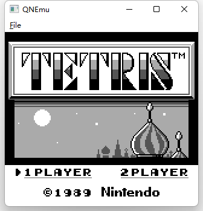

# QNEmu

[](https://github.com/QShen3/qnemu/actions/workflows/ci.yml)

QNEmu is a Nintendo Game Boy / Game Boy Color emulator written in C++20.
It is also a study project for computer architecture and software design: the
code is split into small, testable hardware blocks, with host-facing display,
sound and save services kept outside the console implementation. The long-term
goal is to support more consoles and handhelds with the same host layer.



## Highlights

- Cycle-oriented SM83 CPU core with interrupts, HALT and STOP.
- Dot-level PPU: background/window pixel FIFO, sprites, CGB palettes and exact
  `dmg-acid2` / `cgb-acid2` output.
- Four-channel APU with a DIV-APU frame sequencer, mixer, DC filter and
  low-pass output stage.
- Timer/divider, joypad, OAM DMA/HDMA and serial I/O.
- Serial link play for two and four players (DMG-07 protocol), plus two-player
  Game Boy Color infrared.
- Super Game Boy command protocol, palette/attribute colorization and custom
  borders.
- Battery-backed SRAM saves with named slots, backups and import/export, plus
  MBC3 RTC persistence.
- ZIP/7z/RAR ROM archives, a built-in No-Intro game database, parallel library
  scanning and text/region/language filters.
- Qt Quick QML shell with platform-native styling.
- 300+ unit tests and 173 curated test ROMs (Blargg, Mooneye, acid2) in CTest.

## Cartridge support

| Mapper | Status | Notes |
| ------ | ------ | ----- |
| No MBC | ✅ | ROM only |
| MBC1 / MBC1M | ✅ | unit + Mooneye MBC tests |
| MBC2 | ✅ | built-in 512×4 RAM |
| MBC3 / MBC30 | ✅ | RTC with `.rtc` persistence |
| MBC5 | ✅ | 9-bit ROM bank, 16 RAM banks, rumble bit |
| MBC6 | ✅ | Net de Get; 32 KiB SRAM + 1 MiB flash persisted in `.sav` |
| HuC1 | ✅ | IR port not connected |
| MBC7, MMM01, HuC3, Camera, TAMA5 | ❌ | not implemented |

## Build

```bash
cmake -S . -B build -DCMAKE_BUILD_TYPE=Debug
cmake --build build
ctest --test-dir build --output-on-failure
```

The executable is written to `build/qnemu/qnemu`. Requires a C++20 compiler,
CMake >= 3.16, Qt >= 6.3 and libarchive; Google Test is needed for the test
build. CMake presets (`debug`, `release`, `coverage`, `analyze`), dependency
install commands and packaging notes are in [`doc/building.md`](doc/building.md).

## Quick start

```bash
./build/qnemu/qnemu --rom path/to/game.gb                 # DMG/GBC by cartridge type
./build/qnemu/qnemu --launch-platform sgb --rom game.gb   # run as Super Game Boy
./build/qnemu/qnemu --rom game1.gb --link-rom game2.gb    # two-player link play
```

The GUI opens a library window with the GB and GBC collections; clicking a row
starts the game in a separate game window at the configured scale. Settings
cover the startup platform, library folders, save and screenshot folders, audio,
game scale and named key profiles (defaults: WASD, J/K for A/B, 3/2 for
Start/Select). Screenshots save the current frame at 160×144, or 256×224 with
the SGB border.

See [`doc/usage.md`](doc/usage.md) for the full tour: launch platform
semantics, the library, ROM archives, the game database, searching and save
management.

## Documentation

| Document | Contents |
| -------- | -------- |
| [`doc/building.md`](doc/building.md) | Requirements, presets, options, coverage, dependencies, packaging |
| [`doc/usage.md`](doc/usage.md) | CLI, library, settings, key bindings, database, archives, save data |
| [`doc/architecture.md`](doc/architecture.md) | Project structure, platform selection, CPU/PPU/APU/MMU notes |
| [`doc/testing.md`](doc/testing.md) | Test suites, ROM runner, curated test ROM lists |
| [`doc/boot-roms.md`](doc/boot-roms.md) | Shipped boot ROMs, licensing and startup behaviour |
| [`doc/serial-link.md`](doc/serial-link.md) | Link cable, DMG-07 four-player adapter, infrared |
| [`doc/rom-database.md`](doc/rom-database.md) | No-Intro snapshot sources, status rules, regeneration |

## Project structure

```text
qnemu/
├── main.cpp     QGuiApplication + QML engine setup
├── ui/          Qt/QML host layer (library, settings, game view)
├── display/     DisplayInterface and FrameBuffer headers
├── sound/       Qt Multimedia audio output
├── save/        battery-save and RTC persistence
└── gb/          Game Boy implementation (cpu, ppu, apu, timer, cartridge,
                 memory, joypad, mmu, interrupt, sgb, platform)
```

Each hardware block is a Qt-free static library; the `gb` system library links
them together, and the QML executable injects the display, audio and input
backends. See [`doc/architecture.md`](doc/architecture.md) for how the
DMG/SGB/CGB platform assemblies are built and how the timing-sensitive code is
shared between them.

## Known limitations

- MBC7, MMM01, HuC3, Camera and TAMA5 cartridges are not implemented.
- The Mobile Adapter GB serial device / HTTP server is not emulated, so
  Net de Get's download path remains unavailable even though downloaded flash
  contents now persist in its `.sav` file.
- SGB sound commands (`SOUND`/`SOU_TRN`), the SGB boot animation and visual
  `MASK_EN` effects are not implemented. The command/palette/attribute
  protocol, borders and colorization are implemented.
- Save states, speed settings, video filters, Vulkan/DirectX backends and a
  global shortcut remapping editor are not implemented yet.
- Cover art is not implemented; the library shows title, publisher, region,
  languages and the database status badge.
- The library references ROMs in place; copying/importing into a managed
  folder and deleting ROM files from the UI are not implemented.
- Link play: adapter chaining / 16-player FaceBall, external IR devices
  (Pokémon Pikachu 2 etc.) and exact DMG-07 microsecond timing are not
  emulated (see [`doc/serial-link.md`](doc/serial-link.md)).
- Gamepad, replay and network input backends are future work; input is
  keyboard-mapped only.

## Feature matrix

| Feature | Status |
| ------- | ------ |
| CPU / PPU / APU / interrupts / timer | ✅ unit + ROM tests |
| OAM DMA / HDMA | ✅ unit + Mooneye |
| Serial link (2/4 players) | ✅ unit + ROM tests |
| Infrared link | ✅ unit + two-instance ROM test |
| MBC1–MBC6, HuC1, MBC30 | ✅ (see cartridge table) |
| Boot ROMs (DMG/CGB/SGB) | ✅ Mooneye boot tests + acid2 |
| CGB DMG colorization | ✅ unit + manual |
| Battery saves / save manager / MBC3 RTC | ✅ unit |
| QML UI, library, archives, filters, settings, screenshots, key profiles | ✅ |
| Save states | ❌ |
| Speed setting / video filtering / Vulkan / DirectX | ❌ |

## Thanks

- [Pan Docs](https://gbdev.io/pandocs/) and
  [The Cycle-Accurate Game Boy Docs](https://github.com/AntonioND/giibiiadvance/blob/master/docs/TCAGBD.pdf)
- [gb-opcodes](https://gbdev.github.io/gb-opcodes/optables/) and
  [SingleStepTests/sm83](https://github.com/SingleStepTests/sm83)
- [SameBoy](https://github.com/LIJI32/SameBoy) (CGB boot ROM reimplementation,
  compatibility palette data) and [Bootix](https://github.com/Ashiepaws/Bootix)
- [Blargg's test ROMs](https://github.com/crzysdrs/blarggs-test-roms),
  [Mooneye Test Suite](https://github.com/Gekkio/mooneye-test-suite),
  [dmg-acid2](https://github.com/mattcurrie/dmg-acid2) and
  [cgb-acid2](https://github.com/mattcurrie/cgb-acid2)
- [mGBA](https://github.com/mgba-emu/mgba) and
  [Coffee GB](https://github.com/trekawek/coffee-gb)
