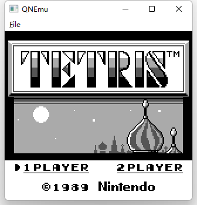

# QNEmu

[](https://github.com/QShen3/qnemu/actions/workflows/ci.yml)

QNEmu is a Nintendo Game Boy / Game Boy Color emulator written in C++20.
It is also a study project for computer architecture and software design: the
code is split into small, testable hardware blocks, with host-facing display,
sound and save services kept outside the console implementation. The long-term
goal is to support more consoles and handhelds with the same host layer.



## Highlights

- Cycle-oriented SM83 CPU core with interrupts, HALT and STOP.
- Dot-level PPU: background/window pixel FIFO, sprites, CGB palettes and
  exact `dmg-acid2` / `cgb-acid2` output.
- Four-channel APU with a DIV-APU frame sequencer, mixer, DC filter and
  low-pass output stage.
- Timer/divider, joypad and OAM DMA/HDMA.
- Serial data transfer with an in-process link cable for two-player games.
- Super Game Boy command protocol, palette/attribute colorization, the
  default 256×224 border and custom border transfers.
- MBC1, MBC1M, MBC2, MBC3, MBC30, MBC5 and HuC1 cartridge mappers.
- Battery-backed SRAM saves and MBC3 RTC persistence.
- ZIP/7z/RAR ROM archives through libarchive, read in memory and matched against the built-in database.
- Parallel background library scan with a loading overlay, plus text search and region/language/status filters.
- Qt Quick QML shell with platform-native Quick Controls styling.
- 460 CTest cases, including 168 curated test ROMs.

## Build

### Requirements

- A C++20 compiler (GCC >= 9, Clang >= 12, or MSVC 2019+)
- CMake >= 3.16 (>= 3.20 for the bundled presets)
- Qt >= 6.3 with Core, Gui, Multimedia, Concurrent, Qml, Quick,
  QuickControls2 and QuickDialogs2
- libarchive >= 3.x (ROM archive support)
- Google Test >= 1.10 (only when building the tests)

### Commands

```bash
cmake -S . -B build -DCMAKE_BUILD_TYPE=Debug
cmake --build build
ctest --test-dir build --output-on-failure
```

The executable is written to `build/qnemu/qnemu`.

CMake presets are recommended:

```bash
cmake --preset debug
cmake --build --preset debug
ctest --preset debug
```

| Preset     | Description                                   |
| ---------- | --------------------------------------------- |
| `debug`    | Debug build in `build/`                       |
| `release`  | Release build in `build-release/`             |
| `coverage` | Debug build with coverage instrumentation     |
| `analyze`  | Debug build with clang-tidy and cppcheck      |

### Options

| Option                     | Default | Description                                        |
| -------------------------- | ------- | -------------------------------------------------- |
| `BUILD_TESTING`            | `ON`    | Build unit tests (requires Google Test)            |
| `QNEMU_WARNINGS_AS_ERRORS` | `ON`    | Treat compiler warnings as errors                  |
| `QNEMU_ENABLE_CLANG_TIDY`  | `OFF`   | Run clang-tidy while compiling                     |
| `QNEMU_ENABLE_CPPCHECK`    | `OFF`   | Run cppcheck while compiling                       |
| `QNEMU_ENABLE_COVERAGE`    | `OFF`   | Instrument the build and add a `coverage` target   |

### Coverage

```bash
cmake -S . -B build -DQNEMU_ENABLE_COVERAGE=ON
cmake --build build --target coverage
```

This requires `gcovr` for GCC/Clang builds, or OpenCppCoverage for MSVC.

### Installing dependencies

macOS with Homebrew:

```bash
brew install cmake ninja qt googletest libarchive
```

Debian/Ubuntu:

```bash
sudo apt install cmake ninja-build qt6-base-dev qt6-multimedia-dev \
    qt6-declarative-dev libarchive-dev libgtest-dev libgmock-dev
```

Homebrew's libarchive is keg-only; CMake finds it automatically when `brew` is
available. If you use a different prefix, pass
`-DCMAKE_PREFIX_PATH="$(brew --prefix libarchive)"`.

The Qt Quick runtime QML modules (`QtQuick`, `QtQuick.Controls`,
`QtQuick.Dialogs`) are needed to run the GUI; on distros that split them out,
install the `qml6-module-qtquick*` packages for your Qt version.

## Boot ROMs

qnemu ships three prebuilt, free boot ROMs:

| File | Model | Notes |
| --- | --- | --- |
| `dmg_boot.bin` | DMG | Bootix (CC0), 256 B; displays the cartridge-header logo |
| `cgb_boot.bin` | CGB | SameBoy CGB reimplementation with the QNEMU wordmark |
| `sgb_boot.bin` | SGB | qnemu clean-room SGB header forwarder (MIT), 256 B |

The CGB image is derived from [SameBoy](https://github.com/LIJI32/SameBoy)'s
Expat/MIT-licensed CGB boot ROM. The DMG image is derived from
[Bootix](https://github.com/Ashiepaws/Bootix), which is CC0. The SGB image is
qnemu's own implementation of the documented SGB packet protocol. See
`third_party/sameboy/README.md`, `third_party/bootix/README.md`,
`third_party/sgb-boot/README.md` and their `LICENSE` files.

SameBoy's DMG and SGB boot ROMs are **not** shipped: they assemble to binaries
that are byte-identical to Nintendo's official DMG/SGB boot ROMs. Do not commit
dumps of your own; use them locally only.

All three binaries are committed, so the normal build needs **no RGBDS
dependency**. Rebuilding is optional and documented in the corresponding
`src/build.sh` scripts.

Every model runs its boot ROM at startup; there is no separate HLE post-boot
path in the emulator:

- DMG runs Bootix and shows the cartridge-header logo (not a QNEMU wordmark);
- CGB runs the QNEMU image. CGB-capable cartridges stay in CGB mode, while
  DMG-only cartridges switch to DMG compatibility through KEY0 and keep the CGB
  PPU registers available. The ROM picks the per-game compatibility palette;
  hold a direction, optionally with A/B, while the logo is shown to choose one
  of the 16 manual combinations;
- SGB runs the clean-room header forwarder, then hands off to the HLE SGB
  BIOS. The border/palette menus remain HLE; this ROM does not add a fake
  SNES-side boot animation.

The only post-boot shortcut left is the test runner's `--boot-model`, which
reproduces official model-specific CPU/DIV/I-O state for Mooneye tests.

The boot ROMs pass Mooneye `boot_regs-cgb`, `boot_hwio-C`,
`boot_regs-dmgABC`, `boot_regs-sgb`, `boot_hwio-S`, and the CGB/DMG acid2
image tests. `boot_div-*` and `boot_hwio-dmgABCmgb` are not registered: they
assert the official ROMs' exact cycle counts/DIV values, which these
reimplementations do not reproduce.

CI runs `tests/rom/check_official_boot_roms.py`, which rejects tracked files
matching known official DMG/MGB/SGB/SGB2/CGB/CGB0/AGB boot ROMs.

## Usage

```bash
./build/qnemu/qnemu
./build/qnemu/qnemu --launch-platform gbc   # override the platform for this run
./build/qnemu/qnemu --launch-platform gb
./build/qnemu/qnemu --launch-platform sgb
./build/qnemu/qnemu --rom path/to/game.gb
```

`-p` is accepted as a shorthand for `--launch-platform`. `--rom` loads a ROM on
startup; without it, use **File → Open...**. The launch platform overrides the
per-cartridge-type preferences for the current run. When it is omitted, DMG-only
and dual-mode cartridges use their own **Startup platform** setting in General,
while GBC-only cartridges always start on **Game Boy Color**. On the GBC
platform, a dual-mode (`0x80`) or CGB-only (`0xC0`) cartridge runs in native CGB
mode, while a DMG-only cartridge runs in DMG compatibility mode with the CGB
compatibility palette, so monochrome games are colorized. The GB platform
forces the DMG CPU/PPU path. SGB keeps the DMG CPU/PPU path but enables the
Super Game Boy command protocol, palette and attribute commands, the default SGB
border and custom border transfers (`CHR_TRN`/`PCT_TRN`/`ATTR_TRN`/`PAL_TRN`).
`--model dmg|sgb|cgb` remains as a deprecated alias for `--launch-platform`.

The library and the game view are separate windows. The library window keeps a
comfortable fixed layout independent of the game scale; the game window opens
at the configured scale and can be resized. Closing the game window pauses
emulation; click the same library row again to resume, or use
**Game → Resume** (Ctrl+P) or Space from the game window.

The home page has two library tabs (cartridge type, not launch platform):

- **Open ROM...** plays a ROM immediately in the game window. ROMs outside the
  configured library folders are added to the library as references; the
  original file is never copied or moved.
- **Add Game...** adds a ROM to the library without starting it.
- Click a library row to run it. Clicking the already-loaded game resumes it
  instead of reloading; the row shows a **Running** or **Paused** badge. The row
  menu can remove it from the library without deleting the file.
- **Settings...** opens the settings window with the startup platform, library
  paths, save path, screenshots, game scale, audio and key profiles.
- **Screenshot** saves the current frame (160×144, or 256×224 with the SGB
  border) using the configured output folder and format.
- **View → Library / Game** raises the library or game window.
- **Game → Pause / Resume** (Ctrl+P) pauses or resumes the running game. Closing
  the game window or switching back to the library pauses it automatically.

The settings window has four pages:

- **General**: game-window scale (100/150/200%), audio enable, the startup
  platform for grey and dual-mode cartridges, save folder, screenshot folder and
  format (the format list comes from Qt's image writers). The library window is
  not affected by the scale setting.
- **Game Boy**: the ROM folder scanned for the GB library (grey and dual-mode
  cartridges).
- **Game Boy Color**: the GBC-only ROM folder. GBC-only cartridges always start
  on Game Boy Color, so there is no per-type preference for them.
- **Controls**: named key profiles, profile creation/deletion, and click-to-capture
  key bindings. Changes apply immediately.

Default key bindings (each profile can be changed in **Settings → Controls**):

| Joypad | Key |
| ------ | --- |
| Up     | W   |
| Down   | S   |
| Left   | A   |
| Right  | D   |
| A      | J   |
| B      | K   |
| Start  | 3   |
| Select | 2   |

## Game database

The library ships a No-Intro snapshot for Game Boy and Game Boy Color.  It
replaces the cartridge header title with the canonical database title, adds
developer/publisher/region/languages/release information, and shows an
**Official** badge when a ROM's SHA-1 matches a licensed release.  Known
prototype, aftermarket, unlicensed, pirate and homebrew dumps are still
identified, but use their own badge instead of "Official".  A ROM that is not
in the database keeps the header metadata and has no badge.

The snapshot is built into the executable, so matching needs no network access.
Open a row's **⋯ → Game information** menu to see the database name, all
metadata, CRC32/SHA-1 and the source/license.  See
[`doc/rom-database.md`](doc/rom-database.md) for sources, status rules,
language inference and the regeneration workflow.

## Serial link

The library header and each game's `⋯` menu can start link play.  Select two
games (or **Same game** twice) and the game window opens with two screens side
by side.  Click a screen to give it keyboard focus; Space or Ctrl+P pauses
both.  `--rom game1.gb --link-rom game2.gb` starts the same mode directly.

Before starting, a setup dialog chooses the save for each player.  The default
**Game save** is the file used in single-player, so Pokémon trades and other
linked progress carry straight back into normal play.  **Link save 1/2** are
persistent separate slots for cases where both players use the same ROM; the
dialog warns instead of letting two running games share one save file.  See
[`doc/serial-link.md`](doc/serial-link.md) for the transport interface, test
coverage and current limitations.

Each game's `⋯` menu also has **Save data...**: play any slot in single-player,
rename the three slots, copy between slots, create a timestamped backup,
restore or delete backups, import/export a `.sav` (with its sibling `.rtc` when
present), or delete a slot.  Backups go to the `backups` folder inside the save
directory and can be restored from the manager.

## ROM archives

The library also scans `.zip`, `.7z` and `.rar` files through libarchive. An
archive must contain exactly one `.gb`, `.gbc` or `.sgb` entry; it is read into
memory, never extracted to disk. The inner ROM is hashed and matched against
the built-in database, so archives get the same Official badges and metadata as
plain ROMs. Opening an archive uses the archive filename for save files, so
`Tetris (World).zip` still produces `Tetris (World).sav`.

Encrypted, corrupt, oversized and multi-ROM archives are rejected instead of
being guessed. The library row stays unverified, and opening the archive shows
the reason in the status toast. The first scan runs in parallel on Qt's thread
pool and keeps the library visible with a loading overlay; later scans in the
same session use an in-memory cache.

When packaging a macOS `.app` or a Windows build, bundle libarchive (or link it
statically), since Homebrew/vcpkg library paths are machine-specific. libarchive
covers the common ZIP methods (store/deflate/bzip2/lzma/xz/zstd); Deflate64 and
some AES variants are not supported.

## Searching the library

The search field covers title, publisher, developer, serial, genre, checksum,
platform and archive entry. Region, language and status have dedicated
dropdown filters. Search terms are case-insensitive and space-separated; every
term must match, and all filters combine. The tab counts and the empty state
follow the active filters.

## Project structure

The host layer and the console implementation are deliberately separate:

```text
qnemu/
├── main.cpp            QGuiApplication + QML engine setup
├── ui/                 Qt/QML host layer
│   ├── *.qml           library, game window, settings and shared components
│   ├── AppController.* QML-facing C++ controller
│   ├── AppSettings.*   persistent global/platform settings
│   ├── GameLibrary.*   ROM scan, metadata and library models
│   ├── RomDatabase.*   built-in No-Intro metadata index
│   ├── RomArchive.*    libarchive-backed zip/7z/rar reader
│   └── EmulatorItem.*  QQuickPaintedItem frame view and key mapping
├── display/            DisplayInterface and FrameBuffer headers
├── sound/              Qt Multimedia audio output (shared host service)
├── save/               battery-save and RTC persistence (shared service)
└── gb/                 Game Boy implementation
    ├── cpu/            SM83 core
    ├── interrupt/      IF/IE and interrupt priority
    ├── gpu/            PPU timing core, DMG/CGB video paths, FIFO, renderer
    ├── apu/            APU and four channels
    ├── timer/          DIV/TIMA timer
    ├── cartridge/      cartridge header, MBCs
    ├── memory/         DMG/CGB work RAM and high RAM
    ├── joypad/         FF00 joypad matrix
    ├── mmu/            DMG/CGB address decoding and CPU bus adapters
    ├── platform/       DMG/SGB/CGB platform assemblies
    ├── sgb/            SGB command receiver, colorizer and frame sink
    └── Gb.cpp          host-side system facade
```

Each hardware block is a separate Qt-free static library:

- `gb_cpu`
- `gb_interrupt`
- `gb_ppu`
- `gb_sgb`
- `gb_apu`
- `gb_timer`
- `gb_cartridge`
- `gb_memory`
- `gb_joypad`
- `gb_mmu`

`gb` is the complete GB system library. It links the device libraries
publicly and only the save service privately. The host display, audio sink and
optional input backend are injected by the executable, so `gb` itself does not
depend on Qt Quick, Qt Widgets or Multimedia. The QML executable links `gb`,
`sound` and the Qt Quick modules; the headless ROM runner links the device
libraries it needs without pulling in Qt Multimedia or the GUI.

Platform selection is separate from cartridge capability. `Gb` owns the
emulation thread, pause/save service and host interfaces, while
`GameBoyPlatform` owns an assembled device graph:

- `DmgPlatform` builds `DmgMmu`/`DmgCpuBus`/`DmgWorkRam` and the `DmgPpu`
  timing/video path.
- `SgbPlatform` extends `DmgPlatform` with `GbSgb` and installs
  `SgbColorizer`/`SgbFrameSink`. The PPU itself only knows `PpuColorizer` and
  `PpuFrameSink`, so `gb_ppu` no longer depends on `gb_sgb`.
- `CgbPlatform` builds `CgbMmu`/`CgbCpuBus`/`CgbWorkRam` and `CgbPpu`, keeping
  the CGB boot ROM's DMG compatibility path for grey cartridges.

The PPU is split into a shared timing core (`GbPpu`) and a `PpuVideo`
implementation: `DmgPpuVideo` owns the monochrome path, while
`CgbPpuVideo` owns VRAM banking, palette RAM, HDMA and DMG-compatibility
rendering. The dot clock, mode transitions, OAM DMA and interrupts remain
shared, so the timing-sensitive code is not duplicated.

Cartridge type is derived from the header, not the file extension: `0xC0` is
CGB-only, `0x80` is dual-mode, and anything else is DMG-only. The two General
preferences select the startup platform for DMG-only and dual-mode cartridges;
CGB-only always selects GBC.

### User interface

The application shell is QML and uses two top-level windows. `Main.qml` is the
library/home window; `GameWindow.qml` hosts the `EmulatorItem` and opens only
when a ROM is running. `AppController` owns the `Gb` instance and exposes only a
small property/action surface, while `EmulatorItem` implements
`DisplayInterface` and `InputInterface` and paints the frame (160×144, or
256×224 with an SGB border) through a `QQuickPaintedItem`. The Quick Controls style is platform-selected: `macOS` on
macOS, `FluentWinUI3` on Windows, `iOS` on iOS, and `Fusion` as the portable
fallback. Native Quick Controls styles require a recent Qt (`macOS` in 6.7+,
`FluentWinUI3` in 6.8+); older Qt versions use Fusion. ROM selection uses the
native `FileDialog`; the File/View menus live in the `ApplicationWindow` menu
bar, which maps to the system menu bar on macOS and appears in-window on other
platforms.

The library window has a fixed comfortable size and is not affected by the
game scale. The game window is resized to the 100/150/200% preset. Closing the
game window or returning to the library pauses the emulator; the paused frame
stays visible behind a **Paused** overlay. Clicking the same library row, or
**Game → Resume** (Ctrl+P or Space in the game window), continues. The library
row shows **Running** or **Paused** for the current game. **View → Game** raises
the window again.
The settings window is positioned once when it opens and stays put when the game
window is resized.

`GameLibrary` scans the configured GB/GBC folders and reads cartridge headers
for title, publisher, region and platform. Platform classification uses the
CGB flag, not the file extension: CGB-only cartridges (`0xC0`) go to the GBC
library, while DMG and dual-mode (`0x80`) cartridges stay in the GB library so
they can be launched as DMG, SGB or CGB. ROMs opened from other folders are
stored as references, so the original collection is never copied or
reorganized. The
library page uses a compact header, a platform switcher with live counts and
rounded game cards with a platform badge, publisher/region line and a hover
action menu; an empty library shows a cartridge illustration and shortcuts to
add a game or open the settings.

The settings window is a sidebar layout with grouped cards instead of a flat
form:

- **General**: game-window scale, audio, startup platform for grey and
  dual-mode cartridges, screenshot folder/format and save folder.
- **Game Boy**: library folder, a live count and a rescan button.
- **Game Boy Color**: library folder, a live count and a rescan button.
  CGB-only cartridges always start on Game Boy Color.
- **Controls**: profile management and a two-column key binding grid.

All paths, scale, audio, screenshot settings and key profiles persist through
`QSettings`; key bindings apply to `EmulatorItem` immediately.

When a DMG-only cartridge is launched on the GBC platform, the PPU keeps the
DMG tile/attribute path but maps the four shades through the CGB compatibility
palettes. A dual-mode cartridge launched on the GBC platform uses the native CGB
PPU path instead. The CGB boot ROM performs the per-game selection: Nintendo
license check, title checksum, duplicate checksums disambiguated by the fourth
title character, and the palette combination table. Holding a direction,
optionally with A/B, during the logo overrides it with one of the 16 manual
combinations.

Window backgrounds, controls and text follow the platform palette, so the UI
adapts to light and dark appearance automatically. The game viewport keeps a
black background so the 160×144 frame is not tinted by the theme.

## Emulation notes

### CPU

The SM83 core lives in `qnemu/gb/cpu` and is independent of Qt, the MMU and the
GUI thread:

- `GbCpu` executes one instruction per `step()` and talks to the rest of the
  machine through `CpuBus` (`read` / `write` / `tick`).
- Every memory access is one machine cycle, so instruction timing is expressed
  directly in the instruction implementation instead of a separate table.
- `Registers` is a portable plain struct; flags use the usual `Z N H C` byte,
  with no anonymous unions or endianness assumptions.
- Interrupts are handled at instruction boundaries: IME, the EI
  one-instruction delay, IF/IE priority, HALT, the HALT bug and STOP.
- `GbCpuBus` adapts the MMU's 1 T-cycle `step()` to the CPU's 4 T-cycle bus
  accesses. The emulation thread lives in `Gb`, not in the CPU.

Unit tests are in `tests/gb/cpu/GbCpuTest.cpp` and use a flat `TestBus`.

### PPU

The PPU is split into four Qt-free pieces under `qnemu/gb/gpu`:

- `GbPpu` owns the dot/line clock, LCDC/STAT/LY/LYC state, OAM DMA, HDMA,
  palette RAM and the frame boundary. Mode 3 is driven dot by dot by
  `PpuFifo`; fine-scroll startup, window activation and object fetch penalties
  extend the line as they occur.
- `PpuFifo` is a background/window pixel FIFO. It fetches eight-pixel rows,
  emits one pixel per dot, handles SCX discard and window restarts, and keeps
  the per-pixel background colour/priority data used for object compositing.
  Moving the LCD from off to on restarts line 0 in mode 0 and shortens that
  first line, matching the DMG `lcdon` timing tests.
- `PpuMemory` owns both VRAM banks, OAM and the CGB palette RAM.
- `PpuRenderer` is a stateless pixel/scanline renderer. It is the reference
  implementation used by unit tests and by `PpuFifo` for per-pixel background
  fetches and the final object-compositing pass.

STAT interrupts use an edge/blocking line rather than firing on every mode
change. `GbCpuBus` also implements CGB `KEY0`/`KEY1` and double-speed switching,
including halving the number of peripheral dots per CPU T-cycle. Object fetch
penalties follow the tile-wait rule from Pan Docs; sprites at the left edge
share one alignment cost derived from `OAM X & 7`.

The PPU never touches Qt or `GbCartridgeInterface`. External memory needed by
OAM DMA/HDMA is supplied through a callback, and finished frames are pushed to
`DisplayInterface` as a plain 160×144 `FrameBuffer` (or a 256×224
`SgbFrameBuffer` when the SGB border is active). The QML `EmulatorItem`
paints that buffer into the scene without blocking the emulation thread.

PPU tests live in `tests/gb/gpu/` and cover background/window addressing,
signed tile indexes, DMG/CGB palettes, sprite priority, OAM DMA/HDMA, mode
transitions, STAT/LYC behaviour, the pixel FIFO, LCD enable/disable timing and
full-frame acid2 comparison.

### APU

The APU implements all four hardware channels:

- **CH1**: pulse wave with duty, envelope, length timer and frequency sweep.
- **CH2**: pulse wave with duty, envelope and length timer.
- **CH3**: 32-sample 4-bit wave-table channel with 100/50/25% output levels.
- **CH4**: LFSR noise with 15-bit/7-bit modes, envelope and length timer.

A 512 Hz frame sequencer clocks the length timers at 256 Hz, the CH1 sweep at
128 Hz and the volume envelopes at 64 Hz. It is driven by the DIV-APU falling
edge, so writing DIV synchronises the APU exactly like the hardware (including
the power-on DIV glitch).

The mixer applies NR51 panning and NR50 master volume, models the DACs'
negative slope, high-pass filters the DC offset like the hardware's output
capacitor, and downsamples to 44100 Hz stereo signed 16-bit samples. A 20 ms
fade-in on DAC enable suppresses the power-on click, and a gentle second-order
10 kHz Butterworth low-pass softens the raw square waves. Qt Multimedia plays
the samples through a small ring buffer; when the buffer is full the emulation
thread blocks, which also acts as the speed limiter. Loading a ROM flushes the
audio buffer so the previous game cannot leak into the next one.

Unit tests are in `tests/gb/apu/`. The headless runner can attach the APU with
`--apu`; curated `dmg_sound` / `cgb_sound` tests run with
`ctest --preset debug -L sound`.

The emulation thread is paced to the Game Boy's ~59.7 fps frame rate. The audio
ring drops new samples if the sink stalls instead of blocking the emulator, so
a slow or missing audio device cannot freeze the game.

### Memory and MMU

`GbWorkRam` models the CGB's 8 × 4 KiB work RAM banks:

- Bank 0 is fixed at `C000-CFFF`.
- `SVBK` (`FF70`) selects bank 1–7 at `D000-DFFF`; writing 0 selects bank 1.
- `SVBK` reads back as `0xF8 | bank` and resets to `0xF8`.
- Echo RAM mirrors the selected banks at `E000-FDFF`.
- In DMG compatibility mode `FF70` reads `FF`, writes are ignored, and
  `D000-DFFF` is the fixed upper 4 KiB.

`GbHighRam` owns `FF80-FFFE`. `GbMmu` decodes the full address space and routes
requests to the cartridge, PPU, APU, timer, joypad, RAM and interrupt
controller. `GbCpuBus` adds the CGB `KEY0`/`KEY1` registers and speed switching.

The MMU and memory blocks have their own tests in `tests/gb/mmu/` and
`tests/gb/memory/`.

### Cartridges

| Mapper | Status | Notes |
| ------ | ------ | ----- |
| No MBC | ✅ | ROM only |
| MBC1   | ✅ | unit + Mooneye MBC tests |
| MBC1M  | ✅ | detected from the extra header in bank `$10` |
| MBC2   | ✅ | built-in 512×4 RAM |
| MBC3   | ✅ | RTC register/latch, 1 Hz tick |
| MBC30  | ✅ | MBC3 with 64 KiB SRAM / 4 MiB ROM |
| MBC5   | ✅ | 9-bit ROM bank, 16 RAM banks, rumble bit |
| HuC1   | ✅ | ROM/RAM/battery; IR port not connected |
| MBC6   | ❌ | not implemented |
| MBC7   | ❌ | not implemented |
| MMM01  | ❌ | not implemented |
| HuC3   | ❌ | not implemented |
| Camera / TAMA5 | ❌ | not implemented |

MBC3's RTC protocol and persistence via a timestamped `.rtc` file are
implemented. MBC30 is selected for MBC3 headers with 64 KiB SRAM (or a 4 MiB
ROM). HuC1 reports "no light" from its IR register because no IR backend is
connected yet.

### Saves

Battery-backed cartridges are saved as raw cartridge RAM, without interpreting
the game's save format:

```text
<ApplicationData>/saves/<ROM stem>.sav   raw SRAM
<ApplicationData>/saves/<ROM stem>.rtc   MBC3 RTC registers + timestamp
```

On macOS the default directory is
`~/Library/Application Support/QNEmu/saves`; Qt's `AppDataLocation` is used on
other platforms. `.sav` files are written for battery-backed MBC1/MBC2/MBC3/
MBC5, MBC30 and no-MBC carts. MBC3 RTC carts additionally get an `.rtc` file;
when the ROM is loaded again, elapsed wall-clock time is applied unless the RTC
was halted. Saves are written when a ROM is switched or the emulator closes.
The directory is not configurable in the UI yet; a settings page will expose it
later.

### Input

Host input is separate from rendering. `EmulatorItem` implements
`InputInterface` and maps Qt keys to `GbButton` values; `GbJoypad` only models
the `FF00/P1` matrix and its edge-triggered interrupt. The joypad is therefore
Qt-free, and a future gamepad, replay or network backend can feed it without
touching the renderer.

## Testing

### Unit tests

```bash
ctest --preset debug
./build/tests/qnemu_test --gtest_filter='GbChannel*:GbApu*'
```

The unit suite covers the CPU, PPU/FIFO, APU, timer, joypad, interrupt
controller, memory, MMU/CPU bus, cartridge/MBC code and save manager.

### Test ROM runner

`gb_test_runner` runs a ROM headlessly with a small test bus (ROM/MBC, RAM,
timer, IF/IE, serial and a line counter for VBlank). It understands both common
result protocols:

- Blargg serial output and the Blargg screen console (`Passed` / `Failed`).
- The Mooneye `LD B, B` breakpoint with the Fibonacci register signature.

```bash
./build/tests/rom/gb_test_runner path/to/test.gb
./build/tests/rom/gb_test_runner path/to/test.gb --model dmg --max-cycles 300000000

# attach the real PPU (OAM DMA / LY / STAT / VRAM)
./build/tests/rom/gb_test_runner path/to/test.gb --ppu

# attach the APU (sound register/length/sweep tests)
./build/tests/rom/gb_test_runner path/to/test.gb --apu --model dmg

# render frames and compare against a reference PNG
./build/tests/rom/gb_test_runner path/to/acid2.gb --frames 10 \
    --compare-image path/to/reference.png

# patch ROM bytes before loading (repeatable, offset=hex)
./build/tests/rom/gb_test_runner path/to/test.gb --patch 0x4401=000000

# reproduce a model's post-boot CPU/DIV/I/O state without a boot ROM
./build/tests/rom/gb_test_runner path/to/boot_test.gb \
    --model dmg --boot-model dmgabc
```

Without `--ppu`, the CPU-only bus keeps a tiny LY/VBlank stub. With `--ppu`,
the real PPU handles OAM DMA, VRAM/OAM blocking, STAT/LYC and rendering.

### ROM setup

The ROMs are git submodules:

```text
third_party/gb-test-roms/       # Blargg, prebuilt ROMs
third_party/mooneye-test-roms/  # Mooneye, prebuilt ROMs
third_party/dmg-acid2/          # source + reference image
third_party/cgb-acid2/          # source + reference image
```

Initialize them after cloning:

```bash
git submodule update --init --recursive
```

The acid2 reference images are in the submodules, but the release ROMs are not
stored in git. Fetch them once (SHA-256 verified):

```bash
python3 tests/rom/fetch_acid2_roms.py
```

The default destination is `build/test-roms/acid2`; use
`-DQNEMU_ACID2_ROM_DIR=...` if the ROMs live elsewhere.

CMake registers a curated CPU/timing/PPU subset automatically when the
submodules are present, so plain `ctest` covers them:

```bash
ctest --preset debug -L rom
ctest --preset debug -L blargg
ctest --preset debug -L mooneye
ctest --preset debug -L ppu
ctest --preset debug -L sound
ctest --preset debug -L mbc
ctest --preset debug -L acid2
```

The acid2 tests render 10 frames and require an exact 160×144 match. Use
`-DQNEMU_ENABLE_ROM_TESTS=OFF` to disable the curated tests, or
`-DQNEMU_TEST_ROM_ROOT=...` if the submodules live elsewhere. For an additional
directory tree, `-DQNEMU_TEST_ROMS_DIR=...` registers every `.gb` below it.

To run a directory tree manually and get a summary:

```bash
python3 tests/rom/run_test_roms.py third_party/gb-test-roms \
    --include 'cpu_instrs|instr_timing|mem_timing'

python3 tests/rom/run_test_roms.py third_party/mooneye-test-roms/acceptance \
    --include 'ppu/' --ppu
```

### Curated test ROMs

The current set is **460/460 CTest cases**, including 168 ROM tests.

<details>
<summary>Blargg CPU and timing tests (<code>-L blargg</code>)</summary>

- `cpu_instrs/individual/01-special` … `11-op a,(hl)`
- `cpu_instrs/cpu_instrs`
- `instr_timing/instr_timing`
- `mem_timing/individual/01-read_timing`, `02-write_timing`, `03-modify_timing`
- `mem_timing/mem_timing`
- `mem_timing-2/rom_singles/01-read_timing`, `02-write_timing`, `03-modify_timing`
- `mem_timing-2/mem_timing`
- `interrupt_time` (CGB, requires `--apu` for the speed detector)

</details>

<details>
<summary>Blargg sound tests (<code>-L sound</code>, requires <code>--apu</code>)</summary>

DMG (`--model dmg`):

- `dmg_sound/rom_singles/01-registers`
- `02-len ctr`
- `03-trigger`
- `04-sweep`
- `05-sweep details`
- `06-overflow on trigger`
- `07-len sweep period sync`
- `08-len ctr during power`
- `09-wave read while on`
- `10-wave trigger while on`
- `11-regs after power`
- `12-wave write while on`

CGB (`--model cgb`):

- `cgb_sound/rom_singles/01-registers`
- `02-len ctr`
- `03-trigger`
- `04-sweep`
- `05-sweep details`
- `06-overflow on trigger`
- `07-len sweep period sync`
- `08-len ctr during power`
- `09-wave read while on`
- `10-wave trigger while on`
- `11-regs after power`
- `12-wave`

</details>

<details>
<summary>Blargg OAM corruption tests (<code>-L ppu</code>, requires <code>--ppu</code>)</summary>

DMG (`--model dmg`):

- `oam_bug/rom_singles/1-lcd_sync`
- `2-causes`
- `3-non_causes`
- `4-scanline_timing`
- `5-timing_bug`
- `6-timing_no_bug`
- `7-timing_effect`
- `8-instr_effect`

`7-timing_effect` is run with a small ROM patch that disables the ROM's
optional `write_text_out` log.  The log grows past the 8 KiB cartridge
RAM (about 9.5 KiB of OAM dumps) and overwrites the test code copied to
`$C000`; it is redundant with the console output and is not part of the
checksum.  The OAM corruption and CRC behaviour are unchanged.

</details>

<details>
<summary>Mooneye MBC tests (<code>-L mbc</code>, real <code>GbCartridge</code>/MBC code)</summary>

- `emulator-only/mbc1/bits_bank1`, `bits_bank2`, `bits_mode`, `bits_ramg`
- `emulator-only/mbc1/multicart_rom_8Mb` (MBC1M)
- `emulator-only/mbc1/ram_64kb`, `ram_256kb`
- `emulator-only/mbc1/rom_1Mb`, `rom_2Mb`, `rom_4Mb`, `rom_8Mb`, `rom_16Mb`, `rom_512kb`
- `emulator-only/mbc2/bits_ramg`, `bits_romb`, `bits_unused`, `ram`
- `emulator-only/mbc2/rom_512kb`, `rom_1Mb`, `rom_2Mb`
- `emulator-only/mbc5/rom_512kb`, `rom_1Mb`, `rom_2Mb`, `rom_4Mb`, `rom_8Mb`, `rom_16Mb`, `rom_32Mb`, `rom_64Mb`

</details>

<details>
<summary>Mooneye CPU/interrupt/timer tests (<code>-L mooneye</code>, CPU-only bus)</summary>

- `bits/reg_f`
- `div_timing`
- `ei_sequence`, `ei_timing`
- `halt_ime0_ei`, `halt_ime0_nointr_timing`, `halt_ime1_timing`, `halt_ime1_timing2-GS`
- `if_ie_registers`
- `instr/daa`
- `interrupts/ie_push`
- `intr_timing`
- `pop_timing`
- `rapid_di_ei`
- `reti_intr_timing`
- `timer/div_write`
- `timer/rapid_toggle`
- `timer/tim00`, `timer/tim01`, `timer/tim10`, `timer/tim11`
- `timer/tim00_div_trigger`, `timer/tim01_div_trigger`, `timer/tim10_div_trigger`, `timer/tim11_div_trigger`
- `timer/tima_reload`, `timer/tima_write_reloading`, `timer/tma_write_reloading`

</details>

<details>
<summary>Mooneye boot-state and unused I/O tests (<code>-L boot</code>)</summary>

The runner reproduces the model-specific post-boot CPU registers, DIV phase,
serial clock phase and I/O register values without executing a copyrighted
boot ROM.  `--boot-model` selects `dmg0`, `dmgabc`, `mgb`, `sgb` or `sgb2`.

- `bits/unused_hwio-GS` (DMG, with `--apu`)
- `boot_div-dmg0`, `boot_div-dmgABCmgb`, `boot_div-S`, `boot_div2-S`
- `boot_hwio-dmg0`, `boot_hwio-dmgABCmgb`, `boot_hwio-S`
- `boot_regs-dmg0`, `boot_regs-dmgABC`, `boot_regs-mgb`, `boot_regs-sgb`, `boot_regs-sgb2`
- `serial/boot_sclk_align-dmgABCmgb`

</details>

<details>
<summary>Mooneye PPU/OAM/bus-timing tests (<code>-L ppu</code>, requires <code>--ppu</code>)</summary>

- `add_sp_e_timing`
- `call_timing`, `call_timing2`, `call_cc_timing`, `call_cc_timing2`
- `di_timing-GS`
- `jp_timing`, `jp_cc_timing`
- `ld_hl_sp_e_timing`
- `push_timing`
- `ret_timing`, `ret_cc_timing`, `reti_timing`, `rst_timing`
- `bits/mem_oam`
- `oam_dma/basic`, `oam_dma/reg_read`, `oam_dma/sources-GS` (DMG)
- `oam_dma_start`, `oam_dma_restart`, `oam_dma_timing`
- `ppu/hblank_ly_scx_timing-GS`
- `ppu/intr_1_2_timing-GS`
- `ppu/intr_2_0_timing`
- `ppu/intr_2_mode0_timing`
- `ppu/intr_2_mode0_timing_sprites`
- `ppu/intr_2_mode3_timing`
- `ppu/intr_2_oam_ok_timing`
- `ppu/lcdon_timing-GS`, `ppu/lcdon_write_timing-GS` (DMG)
- `ppu/stat_irq_blocking`
- `ppu/stat_lyc_onoff`
- `ppu/vblank_stat_intr-GS`

</details>

<details>
<summary>Acid2 image tests (<code>-L acid2</code>)</summary>

- `dmg-acid2`: exact 160×144 match against `reference-dmg.png`
- `cgb-acid2`: exact 160×144 match against `reference.png`

</details>

### Known limitations

The curated CTest set registers only passing ROMs; the current 168 registered
ROM tests all pass. The following ROMs are deliberately not registered and
fail when run directly:

- MBC6, MBC7, MMM01, HuC3, Camera and TAMA5 are not implemented.
- SGB sound commands (`SOUND`/`SOU_TRN`), the SGB boot animation and visual
  `MASK_EN` effects are not implemented yet. The command/palette/attribute
  protocol, default border, custom border transfers and colorization are
  implemented.
- Boot ROMs always run: Bootix for DMG, the QNEMU image for CGB and the
  clean-room header forwarder for SGB. `boot_div-*` and
  `boot_hwio-dmgABCmgb` are not pass criteria because they expect the official
  ROMs' exact cycle counts/DIV values.
- The library uses references to the original ROM files. Copy/import into a
  managed folder and deleting the ROM file from the UI are not implemented yet;
  the row menu only removes the library entry.
- Cover art / a game image database is not implemented yet. The library shows
  cartridge title, publisher, region and languages, plus the database status
  badge.
- Library paths are per platform; the save path is global for now, and key
  profiles are global. Richer overlays and a persistent window layout are
  future work.
- Save states, speed settings, video filters, Vulkan/DirectX backends and a
  global shortcut remapping editor are not implemented yet.

## Feature matrix

| Feature          | Implemented | Tested |
| ---------------- | ----------- | ------ |
| CPU              | ✅          | unit + ROM tests |
| PPU              | ✅          | unit + acid2 |
| APU              | ✅          | unit + Blargg sound |
| Interrupts       | ✅          | unit + Mooneye |
| Joypad           | ✅          | unit |
| Serial link      | ✅          | unit + two-instance test + manual |
| Timer / divider  | ✅          | unit + Mooneye |
| OAM DMA / HDMA   | ✅          | unit + Mooneye |
| No MBC           | ✅          | ROM tests |
| MBC1 / MBC1M     | ✅          | unit + Mooneye |
| MBC2             | ✅          | unit + Mooneye |
| MBC3 / MBC30     | ✅          | unit + RTC tests |
| MBC5             | ✅          | unit + Mooneye |
| HuC1             | ✅          | unit (IR not emulated) |
| QML UI           | ✅          | manual smoke test |
| Game library     | ✅          | manual smoke test |
| ROM archives     | ✅          | unit + real zip scan |
| Library filters  | ✅          | unit |
| Settings         | ✅          | manual smoke test |
| Screenshots      | ✅          | manual smoke test |
| Key profiles     | ✅          | manual smoke test |
| Model selection  | ✅          | CLI + settings |
| CGB DMG colorization | ✅      | unit + manual |
| Boot ROMs        | ✅          | Mooneye boot_regs/hwio + acid2 |
| Pause / resume   | ✅          | manual |
| Battery saves    | ✅          | unit |
| Save manager     | ✅          | unit + manual |
| MBC3 RTC         | ✅          | unit |
| Save states      | ❌          | — |
| Speed setting    | ❌          | — |
| Video filtering  | ❌          | — |
| Vulkan backend   | ❌          | — |
| DirectX backend  | ❌          | — |

## Thanks

- [Pan Docs](https://gbdev.io/pandocs/)
- [SameBoy](https://github.com/LIJI32/SameBoy) (Expat/MIT boot ROM reimplementation; qnemu ships a QNEMU-logo CGB variant and uses its compatibility palette data)
- [Bootix](https://github.com/Ashiepaws/Bootix) (CC0 copyright-free DMG boot ROM)
- [The Cycle-Accurate Game Boy Docs](https://github.com/AntonioND/giibiiadvance/blob/master/docs/TCAGBD.pdf)
- [gb-opcodes](https://gbdev.github.io/gb-opcodes/optables/)
- [SingleStepTests/sm83](https://github.com/SingleStepTests/sm83)
- [Blargg's test ROMs](https://github.com/crzysdrs/blarggs-test-roms)
- [Mooneye Test Suite](https://github.com/Gekkio/mooneye-test-suite)
- [Prebuilt Mooneye ROMs](https://github.com/asoderman/Mooneye-Test-Suite-ROMS)
- [dmg-acid2](https://github.com/mattcurrie/dmg-acid2)
- [cgb-acid2](https://github.com/mattcurrie/cgb-acid2)
- [Visual Boy Advance - M](https://github.com/visualboyadvance-m/visualboyadvance-m)
- [mGBA](https://github.com/mgba-emu/mgba)
- [Coffee GB](https://github.com/trekawek/coffee-gb)
