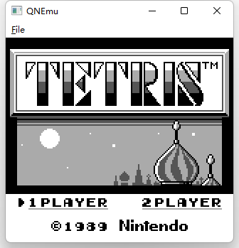

# QNEmu

[](https://github.com/QShen3/qnemu/actions/workflows/ci.yml)

QNEmu is a Nintendo Game Boy / Game Boy Color emulator written in C++20.
It is also a study project for computer architecture and software design: the
code is split into small, testable hardware blocks, with host-facing display,
sound and save services kept outside the console implementation. The long-term
goal is to support more consoles and handhelds with the same host layer.



## Highlights

- Cycle-oriented SM83 CPU core with interrupts, HALT and STOP.
- Dot-level PPU: background/window pixel FIFO, sprites, CGB palettes and
  exact `dmg-acid2` / `cgb-acid2` output.
- Four-channel APU with a DIV-APU frame sequencer, mixer, DC filter and
  low-pass output stage.
- Timer/divider, joypad and OAM DMA/HDMA.
- MBC1, MBC1M, MBC2, MBC3, MBC30, MBC5 and HuC1 cartridge mappers.
- Battery-backed SRAM saves and MBC3 RTC persistence.
- Qt Quick QML shell with platform-native Quick Controls styling.
- 360 CTest cases, including 145 curated test ROMs.

## Build

### Requirements

- A C++20 compiler (GCC >= 9, Clang >= 12, or MSVC 2019+)
- CMake >= 3.16 (>= 3.20 for the bundled presets)
- Qt >= 6.3 with Core, Gui, Multimedia, Qml, Quick, QuickControls2 and
  QuickDialogs2
- Google Test >= 1.10 (only when building the tests)

### Commands

```bash
cmake -S . -B build -DCMAKE_BUILD_TYPE=Debug
cmake --build build
ctest --test-dir build --output-on-failure
```

The executable is written to `build/qnemu/qnemu`.

CMake presets are recommended:

```bash
cmake --preset debug
cmake --build --preset debug
ctest --preset debug
```

| Preset     | Description                                   |
| ---------- | --------------------------------------------- |
| `debug`    | Debug build in `build/`                       |
| `release`  | Release build in `build-release/`             |
| `coverage` | Debug build with coverage instrumentation     |
| `analyze`  | Debug build with clang-tidy and cppcheck      |

### Options

| Option                     | Default | Description                                        |
| -------------------------- | ------- | -------------------------------------------------- |
| `BUILD_TESTING`            | `ON`    | Build unit tests (requires Google Test)            |
| `QNEMU_WARNINGS_AS_ERRORS` | `ON`    | Treat compiler warnings as errors                  |
| `QNEMU_ENABLE_CLANG_TIDY`  | `OFF`   | Run clang-tidy while compiling                     |
| `QNEMU_ENABLE_CPPCHECK`    | `OFF`   | Run cppcheck while compiling                       |
| `QNEMU_ENABLE_COVERAGE`    | `OFF`   | Instrument the build and add a `coverage` target   |

### Coverage

```bash
cmake -S . -B build -DQNEMU_ENABLE_COVERAGE=ON
cmake --build build --target coverage
```

This requires `gcovr` for GCC/Clang builds, or OpenCppCoverage for MSVC.

### Installing dependencies

macOS with Homebrew:

```bash
brew install cmake ninja qt googletest
```

Debian/Ubuntu:

```bash
sudo apt install cmake ninja-build qt6-base-dev qt6-multimedia-dev \
    qt6-declarative-dev libgtest-dev libgmock-dev
```

The Qt Quick runtime QML modules (`QtQuick`, `QtQuick.Controls`,
`QtQuick.Dialogs`) are needed to run the GUI; on distros that split them out,
install the `qml6-module-qtquick*` packages for your Qt version.

## Usage

```bash
./build/qnemu/qnemu
./build/qnemu/qnemu --model cgb   # override the launch model for this run
./build/qnemu/qnemu --model dmg
./build/qnemu/qnemu --model sgb
./build/qnemu/qnemu --rom path/to/game.gb
```

`-m` is accepted as a shorthand for `--model`. `--rom` loads a ROM on startup;
without it, use **File → Open...**. `--model` overrides the **Launch model**
setting for the current run; when it is omitted, the stored setting is used
(CGB by default). With `cgb`, a CGB cartridge runs in CGB mode and a DMG
cartridge runs in DMG compatibility mode with the CGB compatibility palette, so
monochrome games are colorized. `dmg` and `sgb` force the DMG-compatible
CPU/PPU path. SGB-specific features (border, command protocol, palettes) are not
implemented yet, so `sgb` currently behaves like the DMG baseline.

The library and the game view are separate windows. The library window keeps a
comfortable fixed layout independent of the game scale; the game window opens
at the configured scale and can be resized. Closing the game window pauses
emulation; use **Game → Resume** (Ctrl+P) or Space from the game window to
continue.

The home page is a per-platform library:

- **Open ROM...** plays a ROM immediately in the game window. ROMs outside the
  configured library folders are added to the library as references; the
  original file is never copied or moved.
- **Add Game...** adds a ROM to the library without starting it.
- Click a library row to run it. The row menu can remove it from the library
  without deleting the file.
- **Settings...** opens the settings window with the launch model, library
  paths, save path, screenshots, game scale, audio and key profiles.
- **Screenshot** saves the current 160×144 frame using the configured output
  folder and format.
- **View → Library / Game** raises the library or game window.
- **Game → Pause / Resume** (Ctrl+P) pauses or resumes the running game. Closing
  the game window or switching back to the library pauses it automatically.

The settings window has four pages:

- **General**: launch model (CGB/DMG/SGB), game-window scale (100/150/200%),
  audio enable, save folder, screenshot folder and format (the format list
  comes from Qt's image writers). The library window is not affected by the
  scale setting.
- **GB / GBC**: the ROM folder scanned for each platform's library.
- **Controls**: named key profiles, profile creation/deletion, and click-to-capture
  key bindings. Changes apply immediately.

Default key bindings (each profile can be changed in **Settings → Controls**):

| Joypad | Key |
| ------ | --- |
| Up     | W   |
| Down   | S   |
| Left   | A   |
| Right  | D   |
| A      | J   |
| B      | K   |
| Start  | 3   |
| Select | 2   |

## Project structure

The host layer and the console implementation are deliberately separate:

```text
qnemu/
├── main.cpp            QGuiApplication + QML engine setup
├── ui/                 Qt/QML host layer
│   ├── *.qml           library, game window, settings and shared components
│   ├── AppController.* QML-facing C++ controller
│   ├── AppSettings.*   persistent global/platform settings
│   ├── GameLibrary.*   ROM scan, metadata and library models
│   └── EmulatorItem.*  QQuickPaintedItem frame view and key mapping
├── display/            DisplayInterface and FrameBuffer headers
├── sound/              Qt Multimedia audio output (shared host service)
├── save/               battery-save and RTC persistence (shared service)
└── gb/                 Game Boy implementation
    ├── cpu/            SM83 core
    ├── interrupt/      IF/IE and interrupt priority
    ├── gpu/            PPU, pixel FIFO, CGB compatibility palettes
    ├── apu/            APU and four channels
    ├── timer/          DIV/TIMA timer
    ├── cartridge/      cartridge header, MBCs
    ├── memory/         work RAM and high RAM
    ├── joypad/         FF00 joypad matrix
    ├── mmu/            address decoding and CPU bus adapter
    └── Gb.cpp          complete GB system
```

Each hardware block is a separate Qt-free static library:

- `gb_cpu`
- `gb_interrupt`
- `gb_ppu`
- `gb_apu`
- `gb_timer`
- `gb_cartridge`
- `gb_memory`
- `gb_joypad`
- `gb_mmu`

`gb` is the complete GB system library. It links the device libraries
publicly and only the save service privately. The host display, audio sink and
optional input backend are injected by the executable, so `gb` itself does not
depend on Qt Quick, Qt Widgets or Multimedia. The QML executable links `gb`,
`sound` and the Qt Quick modules; the headless ROM runner links the device
libraries it needs without pulling in Qt Multimedia or the GUI.

### User interface

The application shell is QML and uses two top-level windows. `Main.qml` is the
library/home window; `GameWindow.qml` hosts the `EmulatorItem` and opens only
when a ROM is running. `AppController` owns the `Gb` instance and exposes only a
small property/action surface, while `EmulatorItem` implements
`DisplayInterface` and `InputInterface` and paints the 160×144 frame through a
`QQuickPaintedItem`. The Quick Controls style is platform-selected: `macOS` on
macOS, `FluentWinUI3` on Windows, `iOS` on iOS, and `Fusion` as the portable
fallback. Native Quick Controls styles require a recent Qt (`macOS` in 6.7+,
`FluentWinUI3` in 6.8+); older Qt versions use Fusion. ROM selection uses the
native `FileDialog`; the File/View menus live in the `ApplicationWindow` menu
bar, which maps to the system menu bar on macOS and appears in-window on other
platforms.

The library window has a fixed comfortable size and is not affected by the
game scale. The game window is resized to the 100/150/200% preset. Closing the
game window or returning to the library pauses the emulator; the paused frame
stays visible behind a **Paused** overlay, and **Game → Resume** (Ctrl+P or
Space in the game window) continues. **View → Game** raises the window again.
The settings window is positioned once when it opens and stays put when the game
window is resized.

`GameLibrary` scans the configured GB/GBC folders and reads cartridge headers
for title, publisher and region. ROMs opened from other folders are stored as
references, so the original collection is never copied or reorganized. The
library page uses a compact header, a platform switcher with live counts and
rounded game cards with a platform badge, publisher/region line and a hover
action menu; an empty library shows a cartridge illustration and shortcuts to
add a game or open the settings.

The settings window is a sidebar layout with grouped cards instead of a flat
form:

- **General**: launch model, game-window scale, audio, screenshot folder/format
  and save folder.
- **Game Boy / Game Boy Color**: each platform's library folder, a live count
  and a rescan button.
- **Controls**: profile management and a two-column key binding grid.

All paths, scale, audio, screenshot settings and key profiles persist through
`QSettings`; key bindings apply to `EmulatorItem` immediately.

When a DMG cartridge is launched with the CGB model, the PPU keeps the DMG
tile/attribute path but maps the four shades through the CGB compatibility
palettes. The per-game selection follows the boot ROM algorithm: Nintendo
license check, title checksum, duplicate checksums disambiguated by the fourth
title character, and the palette combination table. The boot ROM logo
animation/checksum step itself is not run; the resulting palettes are applied
directly.

Window backgrounds, controls and text follow the platform palette, so the UI
adapts to light and dark appearance automatically. The game viewport keeps a
black background so the 160×144 frame is not tinted by the theme.

## Emulation notes

### CPU

The SM83 core lives in `qnemu/gb/cpu` and is independent of Qt, the MMU and the
GUI thread:

- `GbCpu` executes one instruction per `step()` and talks to the rest of the
  machine through `CpuBus` (`read` / `write` / `tick`).
- Every memory access is one machine cycle, so instruction timing is expressed
  directly in the instruction implementation instead of a separate table.
- `Registers` is a portable plain struct; flags use the usual `Z N H C` byte,
  with no anonymous unions or endianness assumptions.
- Interrupts are handled at instruction boundaries: IME, the EI
  one-instruction delay, IF/IE priority, HALT, the HALT bug and STOP.
- `GbCpuBus` adapts the MMU's 1 T-cycle `step()` to the CPU's 4 T-cycle bus
  accesses. The emulation thread lives in `Gb`, not in the CPU.

Unit tests are in `tests/gb/cpu/GbCpuTest.cpp` and use a flat `TestBus`.

### PPU

The PPU is split into four Qt-free pieces under `qnemu/gb/gpu`:

- `GbPpu` owns the dot/line clock, LCDC/STAT/LY/LYC state, OAM DMA, HDMA,
  palette RAM and the frame boundary. Mode 3 is driven dot by dot by
  `PpuFifo`; fine-scroll startup, window activation and object fetch penalties
  extend the line as they occur.
- `PpuFifo` is a background/window pixel FIFO. It fetches eight-pixel rows,
  emits one pixel per dot, handles SCX discard and window restarts, and keeps
  the per-pixel background colour/priority data used for object compositing.
  Moving the LCD from off to on restarts line 0 in mode 0 and shortens that
  first line, matching the DMG `lcdon` timing tests.
- `PpuMemory` owns both VRAM banks, OAM and the CGB palette RAM.
- `PpuRenderer` is a stateless pixel/scanline renderer. It is the reference
  implementation used by unit tests and by `PpuFifo` for per-pixel background
  fetches and the final object-compositing pass.

STAT interrupts use an edge/blocking line rather than firing on every mode
change. `GbCpuBus` also implements CGB `KEY0`/`KEY1` and double-speed switching,
including halving the number of peripheral dots per CPU T-cycle. Object fetch
penalties follow the tile-wait rule from Pan Docs; sprites at the left edge
share one alignment cost derived from `OAM X & 7`.

The PPU never touches Qt or `GbCartridgeInterface`. External memory needed by
OAM DMA/HDMA is supplied through a callback, and finished frames are pushed to
`DisplayInterface` as a plain 160×144 `FrameBuffer`. The QML `EmulatorItem`
paints that buffer into the scene without blocking the emulation thread.

PPU tests live in `tests/gb/gpu/` and cover background/window addressing,
signed tile indexes, DMG/CGB palettes, sprite priority, OAM DMA/HDMA, mode
transitions, STAT/LYC behaviour, the pixel FIFO, LCD enable/disable timing and
full-frame acid2 comparison.

### APU

The APU implements all four hardware channels:

- **CH1**: pulse wave with duty, envelope, length timer and frequency sweep.
- **CH2**: pulse wave with duty, envelope and length timer.
- **CH3**: 32-sample 4-bit wave-table channel with 100/50/25% output levels.
- **CH4**: LFSR noise with 15-bit/7-bit modes, envelope and length timer.

A 512 Hz frame sequencer clocks the length timers at 256 Hz, the CH1 sweep at
128 Hz and the volume envelopes at 64 Hz. It is driven by the DIV-APU falling
edge, so writing DIV synchronises the APU exactly like the hardware (including
the power-on DIV glitch).

The mixer applies NR51 panning and NR50 master volume, models the DACs'
negative slope, high-pass filters the DC offset like the hardware's output
capacitor, and downsamples to 44100 Hz stereo signed 16-bit samples. A 20 ms
fade-in on DAC enable suppresses the power-on click, and a gentle second-order
10 kHz Butterworth low-pass softens the raw square waves. Qt Multimedia plays
the samples through a small ring buffer; when the buffer is full the emulation
thread blocks, which also acts as the speed limiter. Loading a ROM flushes the
audio buffer so the previous game cannot leak into the next one.

Unit tests are in `tests/gb/apu/`. The headless runner can attach the APU with
`--apu`; curated `dmg_sound` / `cgb_sound` tests run with
`ctest --preset debug -L sound`.

The emulation thread is paced to the Game Boy's ~59.7 fps frame rate. The audio
ring drops new samples if the sink stalls instead of blocking the emulator, so
a slow or missing audio device cannot freeze the game.

### Memory and MMU

`GbWorkRam` models the CGB's 8 × 4 KiB work RAM banks:

- Bank 0 is fixed at `C000-CFFF`.
- `SVBK` (`FF70`) selects bank 1–7 at `D000-DFFF`; writing 0 selects bank 1.
- `SVBK` reads back as `0xF8 | bank` and resets to `0xF8`.
- Echo RAM mirrors the selected banks at `E000-FDFF`.
- In DMG compatibility mode `FF70` reads `FF`, writes are ignored, and
  `D000-DFFF` is the fixed upper 4 KiB.

`GbHighRam` owns `FF80-FFFE`. `GbMmu` decodes the full address space and routes
requests to the cartridge, PPU, APU, timer, joypad, RAM and interrupt
controller. `GbCpuBus` adds the CGB `KEY0`/`KEY1` registers and speed switching.

The MMU and memory blocks have their own tests in `tests/gb/mmu/` and
`tests/gb/memory/`.

### Cartridges

| Mapper | Status | Notes |
| ------ | ------ | ----- |
| No MBC | ✅ | ROM only |
| MBC1   | ✅ | unit + Mooneye MBC tests |
| MBC1M  | ✅ | detected from the extra header in bank `$10` |
| MBC2   | ✅ | built-in 512×4 RAM |
| MBC3   | ✅ | RTC register/latch, 1 Hz tick |
| MBC30  | ✅ | MBC3 with 64 KiB SRAM / 4 MiB ROM |
| MBC5   | ✅ | 9-bit ROM bank, 16 RAM banks, rumble bit |
| HuC1   | ✅ | ROM/RAM/battery; IR port not connected |
| MBC6   | ❌ | not implemented |
| MBC7   | ❌ | not implemented |
| MMM01  | ❌ | not implemented |
| HuC3   | ❌ | not implemented |
| Camera / TAMA5 | ❌ | not implemented |

MBC3's RTC protocol and persistence via a timestamped `.rtc` file are
implemented. MBC30 is selected for MBC3 headers with 64 KiB SRAM (or a 4 MiB
ROM). HuC1 reports "no light" from its IR register because no IR backend is
connected yet.

### Saves

Battery-backed cartridges are saved as raw cartridge RAM, without interpreting
the game's save format:

```text
<ApplicationData>/saves/<ROM stem>.sav   raw SRAM
<ApplicationData>/saves/<ROM stem>.rtc   MBC3 RTC registers + timestamp
```

On macOS the default directory is
`~/Library/Application Support/QNEmu/saves`; Qt's `AppDataLocation` is used on
other platforms. `.sav` files are written for battery-backed MBC1/MBC2/MBC3/
MBC5, MBC30 and no-MBC carts. MBC3 RTC carts additionally get an `.rtc` file;
when the ROM is loaded again, elapsed wall-clock time is applied unless the RTC
was halted. Saves are written when a ROM is switched or the emulator closes.
The directory is not configurable in the UI yet; a settings page will expose it
later.

### Input

Host input is separate from rendering. `EmulatorItem` implements
`InputInterface` and maps Qt keys to `GbButton` values; `GbJoypad` only models
the `FF00/P1` matrix and its edge-triggered interrupt. The joypad is therefore
Qt-free, and a future gamepad, replay or network backend can feed it without
touching the renderer.

## Testing

### Unit tests

```bash
ctest --preset debug
./build/tests/qnemu_test --gtest_filter='GbChannel*:GbApu*'
```

The unit suite covers the CPU, PPU/FIFO, APU, timer, joypad, interrupt
controller, memory, MMU/CPU bus, cartridge/MBC code and save manager.

### Test ROM runner

`gb_test_runner` runs a ROM headlessly with a small test bus (ROM/MBC, RAM,
timer, IF/IE, serial and a line counter for VBlank). It understands both common
result protocols:

- Blargg serial output and the Blargg screen console (`Passed` / `Failed`).
- The Mooneye `LD B, B` breakpoint with the Fibonacci register signature.

```bash
./build/tests/rom/gb_test_runner path/to/test.gb
./build/tests/rom/gb_test_runner path/to/test.gb --model dmg --max-cycles 300000000

# attach the real PPU (OAM DMA / LY / STAT / VRAM)
./build/tests/rom/gb_test_runner path/to/test.gb --ppu

# attach the APU (sound register/length/sweep tests)
./build/tests/rom/gb_test_runner path/to/test.gb --apu --model dmg

# render frames and compare against a reference PNG
./build/tests/rom/gb_test_runner path/to/acid2.gb --frames 10 \
    --compare-image path/to/reference.png
```

Without `--ppu`, the CPU-only bus keeps a tiny LY/VBlank stub. With `--ppu`,
the real PPU handles OAM DMA, VRAM/OAM blocking, STAT/LYC and rendering.

### ROM setup

The ROMs are git submodules:

```text
third_party/gb-test-roms/       # Blargg, prebuilt ROMs
third_party/mooneye-test-roms/  # Mooneye, prebuilt ROMs
third_party/dmg-acid2/          # source + reference image
third_party/cgb-acid2/          # source + reference image
```

Initialize them after cloning:

```bash
git submodule update --init --recursive
```

The acid2 reference images are in the submodules, but the release ROMs are not
stored in git. Fetch them once (SHA-256 verified):

```bash
python3 tests/rom/fetch_acid2_roms.py
```

The default destination is `build/test-roms/acid2`; use
`-DQNEMU_ACID2_ROM_DIR=...` if the ROMs live elsewhere.

CMake registers a curated CPU/timing/PPU subset automatically when the
submodules are present, so plain `ctest` covers them:

```bash
ctest --preset debug -L rom
ctest --preset debug -L blargg
ctest --preset debug -L mooneye
ctest --preset debug -L ppu
ctest --preset debug -L sound
ctest --preset debug -L mbc
ctest --preset debug -L acid2
```

The acid2 tests render 10 frames and require an exact 160×144 match. Use
`-DQNEMU_ENABLE_ROM_TESTS=OFF` to disable the curated tests, or
`-DQNEMU_TEST_ROM_ROOT=...` if the submodules live elsewhere. For an additional
directory tree, `-DQNEMU_TEST_ROMS_DIR=...` registers every `.gb` below it.

To run a directory tree manually and get a summary:

```bash
python3 tests/rom/run_test_roms.py third_party/gb-test-roms \
    --include 'cpu_instrs|instr_timing|mem_timing'

python3 tests/rom/run_test_roms.py third_party/mooneye-test-roms/acceptance \
    --include 'ppu/' --ppu
```

### Curated test ROMs

The current set is **360/360 CTest cases**, including 145 ROM tests.

<details>
<summary>Blargg CPU and timing tests (<code>-L blargg</code>)</summary>

- `cpu_instrs/individual/01-special` … `11-op a,(hl)`
- `cpu_instrs/cpu_instrs`
- `instr_timing/instr_timing`
- `mem_timing/individual/01-read_timing`, `02-write_timing`, `03-modify_timing`
- `mem_timing/mem_timing`
- `mem_timing-2/rom_singles/01-read_timing`, `02-write_timing`, `03-modify_timing`
- `mem_timing-2/mem_timing`
- `interrupt_time` (CGB, requires `--apu` for the speed detector)

</details>

<details>
<summary>Blargg sound tests (<code>-L sound</code>, requires <code>--apu</code>)</summary>

DMG (`--model dmg`):

- `dmg_sound/rom_singles/01-registers`
- `02-len ctr`
- `03-trigger`
- `04-sweep`
- `05-sweep details`
- `06-overflow on trigger`
- `07-len sweep period sync`
- `08-len ctr during power`
- `09-wave read while on`
- `10-wave trigger while on`
- `11-regs after power`
- `12-wave write while on`

CGB (`--model cgb`):

- `cgb_sound/rom_singles/01-registers`
- `02-len ctr`
- `03-trigger`
- `04-sweep`
- `05-sweep details`
- `06-overflow on trigger`
- `07-len sweep period sync`
- `08-len ctr during power`
- `09-wave read while on`
- `10-wave trigger while on`
- `11-regs after power`
- `12-wave`

</details>

<details>
<summary>Blargg OAM corruption tests (<code>-L ppu</code>, requires <code>--ppu</code>)</summary>

DMG (`--model dmg`):

- `oam_bug/rom_singles/1-lcd_sync`
- `2-causes`
- `3-non_causes`
- `4-scanline_timing`
- `5-timing_bug`
- `6-timing_no_bug`
- `8-instr_effect`

`7-timing_effect` still needs more exact timing and is not registered yet.

</details>

<details>
<summary>Mooneye MBC tests (<code>-L mbc</code>, real <code>GbCartridge</code>/MBC code)</summary>

- `emulator-only/mbc1/bits_bank1`, `bits_bank2`, `bits_mode`, `bits_ramg`
- `emulator-only/mbc1/multicart_rom_8Mb` (MBC1M)
- `emulator-only/mbc1/ram_64kb`, `ram_256kb`
- `emulator-only/mbc1/rom_1Mb`, `rom_2Mb`, `rom_4Mb`, `rom_8Mb`, `rom_16Mb`, `rom_512kb`
- `emulator-only/mbc2/bits_ramg`, `bits_romb`, `bits_unused`, `ram`
- `emulator-only/mbc2/rom_512kb`, `rom_1Mb`, `rom_2Mb`
- `emulator-only/mbc5/rom_512kb`, `rom_1Mb`, `rom_2Mb`, `rom_4Mb`, `rom_8Mb`, `rom_16Mb`, `rom_32Mb`, `rom_64Mb`

</details>

<details>
<summary>Mooneye CPU/interrupt/timer tests (<code>-L mooneye</code>, CPU-only bus)</summary>

- `bits/reg_f`
- `div_timing`
- `ei_sequence`, `ei_timing`
- `halt_ime0_ei`, `halt_ime0_nointr_timing`, `halt_ime1_timing`, `halt_ime1_timing2-GS`
- `if_ie_registers`
- `instr/daa`
- `interrupts/ie_push`
- `intr_timing`
- `pop_timing`
- `rapid_di_ei`
- `reti_intr_timing`
- `timer/div_write`
- `timer/rapid_toggle`
- `timer/tim00`, `timer/tim01`, `timer/tim10`, `timer/tim11`
- `timer/tim00_div_trigger`, `timer/tim01_div_trigger`, `timer/tim10_div_trigger`, `timer/tim11_div_trigger`
- `timer/tima_reload`, `timer/tima_write_reloading`, `timer/tma_write_reloading`

</details>

<details>
<summary>Mooneye PPU/OAM/bus-timing tests (<code>-L ppu</code>, requires <code>--ppu</code>)</summary>

- `add_sp_e_timing`
- `call_timing`, `call_timing2`, `call_cc_timing`, `call_cc_timing2`
- `di_timing-GS`
- `jp_timing`, `jp_cc_timing`
- `ld_hl_sp_e_timing`
- `push_timing`
- `ret_timing`, `ret_cc_timing`, `reti_timing`, `rst_timing`
- `bits/mem_oam`
- `oam_dma/basic`, `oam_dma/reg_read`, `oam_dma/sources-GS` (DMG)
- `oam_dma_start`, `oam_dma_restart`, `oam_dma_timing`
- `ppu/hblank_ly_scx_timing-GS`
- `ppu/intr_1_2_timing-GS`
- `ppu/intr_2_0_timing`
- `ppu/intr_2_mode0_timing`
- `ppu/intr_2_mode0_timing_sprites`
- `ppu/intr_2_mode3_timing`
- `ppu/intr_2_oam_ok_timing`
- `ppu/lcdon_timing-GS`, `ppu/lcdon_write_timing-GS` (DMG)
- `ppu/stat_irq_blocking`
- `ppu/stat_lyc_onoff`
- `ppu/vblank_stat_intr-GS`

</details>

<details>
<summary>Acid2 image tests (<code>-L acid2</code>)</summary>

- `dmg-acid2`: exact 160×144 match against `reference-dmg.png`
- `cgb-acid2`: exact 160×144 match against `reference.png`

</details>

### Known limitations

The curated CTest set registers only passing ROMs; the current 136 registered
ROM tests all pass. The following ROMs are deliberately not registered and
fail when run directly:

- Blargg `oam_bug` 1-6 and 8-instr_effect pass, but `7-timing_effect` still
  needs more exact timing and is not registered.
- Mooneye `acceptance/bits/unused_hwio-GS` fails because unused I/O reads do
  not reproduce the hardware values.
- Boot-dependent Mooneye tests (`boot_div*`, `boot_hwio-*`,
  `boot_regs-{dmg0,mgb,sgb,sgb2}` and
  `serial/boot_sclk_align-dmgABCmgb`) fail because no boot ROM is executed and
  the post-boot DIV/I/O state is not fully reproduced. `boot_regs-dmgABC`
  happens to pass because the headless runner sets the DMG post-boot CPU
  registers explicitly.
- MBC6, MBC7, MMM01, HuC3, Camera and TAMA5 are not implemented.
- SGB border, command protocol and palettes are not implemented.
- The CGB boot ROM is not executed: its logo animation, header checksum check
  and boot hand-off are skipped. The compatibility palette selection and data
  are implemented directly instead.
- The library uses references to the original ROM files. Copy/import into a
  managed folder and deleting the ROM file from the UI are not implemented yet;
  the row menu only removes the library entry.
- Cover art / a game image database is not implemented yet. The library shows
  cartridge title, publisher and region.
- Library paths are per platform; the save path is global for now, and key
  profiles are global. Richer overlays and a persistent window layout are
  future work.
- Save states, speed settings, video filters, Vulkan/DirectX backends and a
  global shortcut remapping editor are not implemented yet.

## Feature matrix

| Feature          | Implemented | Tested |
| ---------------- | ----------- | ------ |
| CPU              | ✅          | unit + ROM tests |
| PPU              | ✅          | unit + acid2 |
| APU              | ✅          | unit + Blargg sound |
| Interrupts       | ✅          | unit + Mooneye |
| Joypad           | ✅          | unit |
| Timer / divider  | ✅          | unit + Mooneye |
| OAM DMA / HDMA   | ✅          | unit + Mooneye |
| No MBC           | ✅          | ROM tests |
| MBC1 / MBC1M     | ✅          | unit + Mooneye |
| MBC2             | ✅          | unit + Mooneye |
| MBC3 / MBC30     | ✅          | unit + RTC tests |
| MBC5             | ✅          | unit + Mooneye |
| HuC1             | ✅          | unit (IR not emulated) |
| QML UI           | ✅          | manual smoke test |
| Game library     | ✅          | manual smoke test |
| Settings         | ✅          | manual smoke test |
| Screenshots      | ✅          | manual smoke test |
| Key profiles     | ✅          | manual smoke test |
| Model selection  | ✅          | CLI + settings |
| CGB DMG colorization | ✅      | unit + manual |
| Pause / resume   | ✅          | manual |
| Battery saves    | ✅          | unit |
| MBC3 RTC         | ✅          | unit |
| Save states      | ❌          | — |
| Speed setting    | ❌          | — |
| Video filtering  | ❌          | — |
| Vulkan backend   | ❌          | — |
| DirectX backend  | ❌          | — |

## Thanks

- [Pan Docs](https://gbdev.io/pandocs/)
- [SameBoy](https://github.com/LIJI32/SameBoy) (MIT-licensed CGB boot ROM reimplementation used to cross-check the compatibility palette tables)
- [The Cycle-Accurate Game Boy Docs](https://github.com/AntonioND/giibiiadvance/blob/master/docs/TCAGBD.pdf)
- [gb-opcodes](https://gbdev.github.io/gb-opcodes/optables/)
- [SingleStepTests/sm83](https://github.com/SingleStepTests/sm83)
- [Blargg's test ROMs](https://github.com/crzysdrs/blarggs-test-roms)
- [Mooneye Test Suite](https://github.com/Gekkio/mooneye-test-suite)
- [Prebuilt Mooneye ROMs](https://github.com/asoderman/Mooneye-Test-Suite-ROMS)
- [dmg-acid2](https://github.com/mattcurrie/dmg-acid2)
- [cgb-acid2](https://github.com/mattcurrie/cgb-acid2)
- [Visual Boy Advance - M](https://github.com/visualboyadvance-m/visualboyadvance-m)
- [mGBA](https://github.com/mgba-emu/mgba)
- [Coffee GB](https://github.com/trekawek/coffee-gb)
